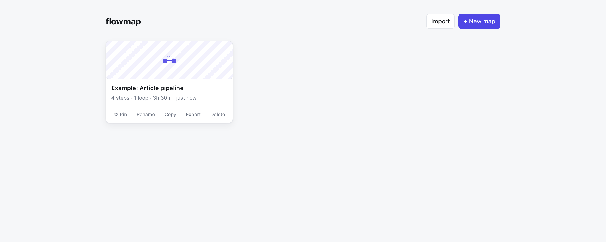

# flowmap

Map how a process actually works — the steps, who does them, how long they take,
and the loops where it doubles back on itself.

Most diagramming tools give you boxes and arrows and stop there. flowmap is built
to be a *living process document*: every step carries a status, an owner, a
duration, and notes, so the map stays useful after the pretty picture is drawn.
It holds any number of maps at once, like a small Drive for process diagrams —
with an account of your own, so your maps follow you across browsers and devices.



## Running it

You need a Postgres database (a free [Neon](https://neon.tech) project works) —
put its connection string in `.env.local`:

```
DATABASE_URL=postgresql://...
```

Then:

```bash
npm install && npm run dev
```

This runs the Vite dev server and a local API dev server together (`concurrently`),
with `/api` proxied from Vite to the API server. Both talk to the same handler
code that runs on the production deployment.

## Using it

- **Accounts** — sign up with an email and password. Your maps are stored under
  your account, not just in one browser, so they're there whichever device you
  sign in from.
- **Dashboard** — the landing page. **Search** filters by name — handy once you
  have more than a screenful of maps. **+ New map** opens a blank one; **Import**
  adds a `.flowmap.json` file to the collection, or merges a whole
  `flowmap-library.json` bundle in (see below). **Export all** downloads every
  map on the dashboard as one bundle. Each card can be pinned, renamed
  (double-click the title, or the row action), duplicated, exported, or
  deleted, without opening it.
- **Steps** — double-click empty canvas, or hit **+ Step**. Select a step to edit
  its title, status, owner, duration, and notes in the side panel. Owner and
  duration surface on the node; status colors its left edge.
- **Flow** — drag from a step's right dot to the next step's left dot.
- **Loops** — drag from a step's top-right dot back to an earlier step's top-left
  dot. It renders as a dashed arc over the row, labeled with the repeat condition
  ("if changes requested").
- **Rollup** — the header keeps a running count of steps, loops, and total time.

## The one interesting bit

Loops are never stored. Nothing on an edge says "I am a loop" — an edge is a loop
because of where it sits in the graph, so re-route the map and the same edge
stops being one on its own.

Deciding *which* edge in a cycle to call the loop is the part that isn't obvious.
The textbook answer is a DFS back-edge search, and it's wrong here: which edge a
DFS blames depends on where the traversal happens to start, so in a
Draft→Review→Draft cycle it will happily label the forward edge as the loop.

[`findBackEdges`](src/graph.ts) instead builds the forward graph greedily,
considering edges most-rightward first — which is the direction these maps are
read — and whatever would close a cycle is a loop. Edges drawn between the
dedicated loop handles are considered last, so an arrow you explicitly drew as a
return arrow stays one.

## Architecture

A Vite + React frontend and a small set of [Vercel functions](api/) under `/api`
sharing one Postgres database (Neon). Auth is plain email/password — passwords
hashed with `scrypt`, sessions as opaque tokens in a `sessions` table and an
`httpOnly` cookie — no third-party auth provider. Every map row belongs to one
user; `pinned` lives on the map itself rather than as a separate list.

Routing between the dashboard and an open map is a `#/map/<id>` hash, not a real
path — no server-side rewrite needed for it. The editor autosaves into the map's
row on a debounce, flushed synchronously (via `fetch(..., { keepalive: true })`)
on navigating away or closing the tab.

**Export** / **Import** move a single map as a `.flowmap.json` file; **Export
all** / **Import** move the whole dashboard as one `flowmap-library.json`
bundle. Either way, import always assigns fresh ids (carrying pinned status
along for a bundle), so re-importing a file — or importing someone else's
export — never collides with what's already on your dashboard. The saved shape
is a plain serializable `MapDoc` ([src/types.ts](src/types.ts)).

## Built with

[React Flow](https://reactflow.dev) for the canvas, Zustand for state, Vite +
React + TypeScript on the frontend; [Neon](https://neon.tech) Postgres and
Vercel functions on the backend. MIT licensed.
